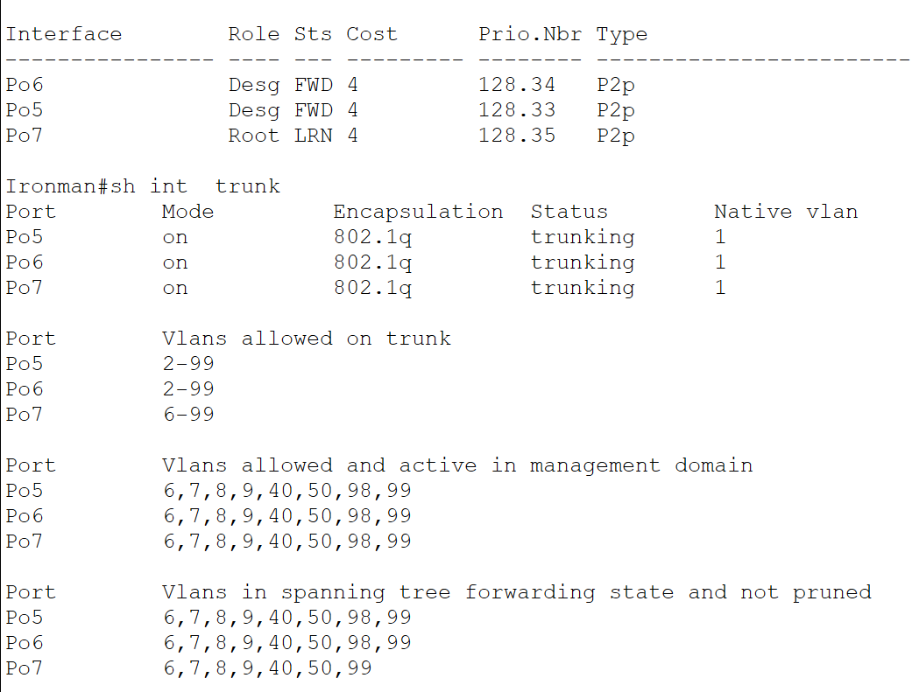
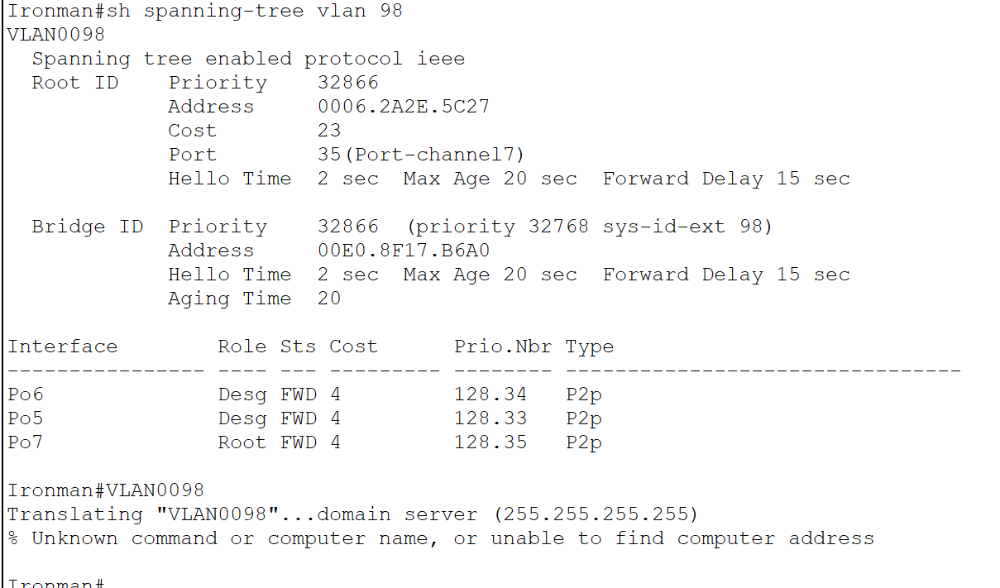
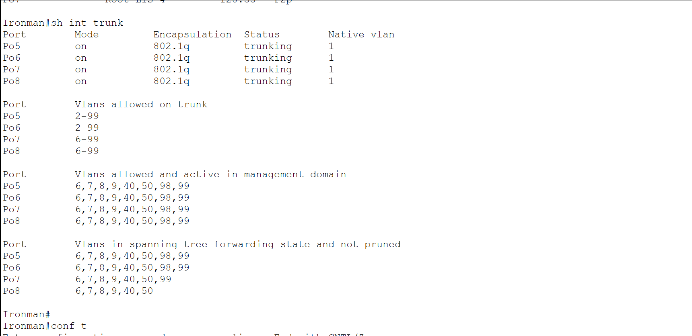
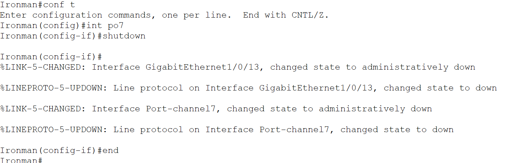
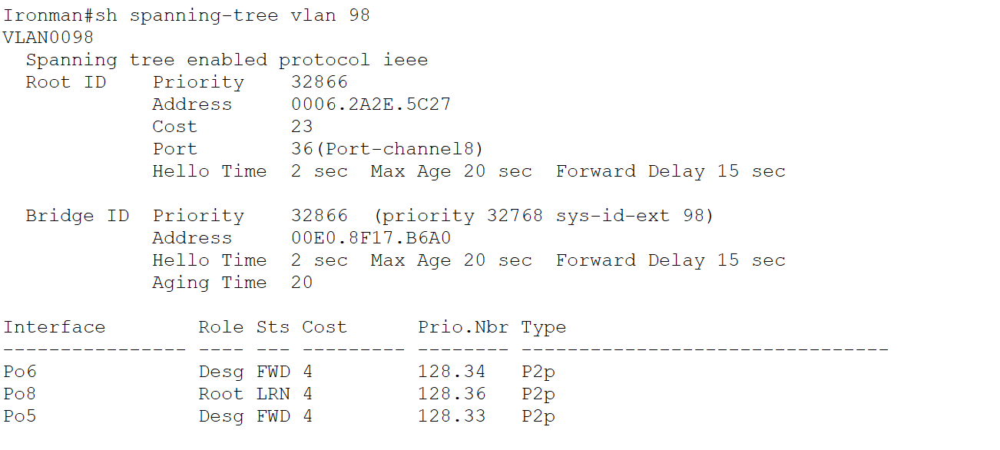
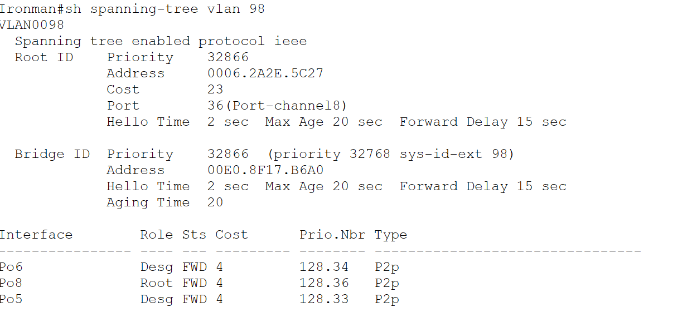

# Hospital Enterprise Network Lab — VLAN 98 Connectivity Incident and STP Failover Validation

**Environment:** Cisco Packet Tracer | Simulated multi-switch hospital enterprise network  
**Case type:** Layer 2 connectivity troubleshooting, EtherChannel, IEEE STP, redundancy testing  
**Final status:** **Connectivity restored; redundant path failover successful; original outage trigger inconclusive**

> **Scope note:** This is a simulated lab incident, not a production hospital outage. This report separates observations from possible explanations. The original connectivity failure was not reproduced after recovery, so no definitive root cause is claimed.

## 1. Network overview

The lab models a multi-floor hospital campus with access switches, multilayer distribution switches, VLAN-separated departments, and central servers. The VLAN 98 backup server is named **BumbleBee**; the VLAN 99 primary server is named **OptimusPrime**.


### Relevant devices and addressing

| Device | Role in this investigation | VLAN 98 address / detail |
|---|---|---|
| **BumbleBee** | Backup server, connected to Bifrost | `192.168.98.10/24`; gateway `192.168.98.1` |
| **OptimusPrime** | Primary server on VLAN 99 | `192.168.99.10/24` |
| **Bifrost** | Layer 2 access switch for the servers | VLAN 98 STP root bridge, MAC `0006.2A2E.5C27` |
| **CaptainAmerica** | Multilayer switch, connects toward Bifrost | VLAN 98 SVI `192.168.98.1/24` |
| **IronMan** | Multilayer switch used for the STP/failover tests | VLAN 98 SVI `192.168.98.2/24` |
| **Thor** | Multilayer switch | VLAN 98 SVI corrected to `192.168.98.3/24` |

**Relevant inter-switch paths:** IronMan ↔ CaptainAmerica uses two *separate* parallel Layer 2 LACP EtherChannels, **Po7** and **Po8**. IronMan also has Po5 and Po6 connections toward Thor. CaptainAmerica connects to Bifrost using Po5 and Po6. These port-channel numbers are locally significant: for example, Po5 on one switch does not necessarily connect to Po5 on every other switch.

The expected STP design is that **one** of the parallel IronMan–CaptainAmerica paths forwards VLAN 98 traffic and the other remains available as an alternate. A blocked alternate path is normal and prevents a Layer 2 loop.

## 2. Incident summary

**Symptom:** IronMan could not ping BumbleBee (`192.168.98.10`) or CaptainAmerica's VLAN 98 SVI (`192.168.98.1`), even though CaptainAmerica could reach BumbleBee. The VLAN 99 primary server remained reachable during the investigation.

The outage was **not** simply explained by a physically disconnected link: EtherChannels were present, and trunk configuration included VLAN 98. However, IronMan's VLAN 98 STP root port, Po7, was observed in **Listening** instead of **Forwarding**, and VLAN 98 was missing from Po7's list of VLANs in the STP forwarding state. Po8 was the alternate blocked path at that point.

**Impact observed:** VLAN 98 reachability from IronMan was impaired. The evidence does not establish that every device or every possible VLAN 98 path was down; IronMan's Po5 and Po6 were still listed as forwarding VLAN 98.

## 3. Investigation and evidence

### A. Layer 3 addressing and ARP

- Checked VLAN 98 SVI addressing on the multilayer switches.
- Discovered a **duplicate address**: Thor initially used `192.168.98.1`, the same address as CaptainAmerica.
- Corrected Thor to `192.168.98.3`; IronMan could then ping Thor's corrected address, and its ARP entry resolved to Thor's MAC `0060.47C7.5E07`.
- IronMan still could not resolve/reach BumbleBee at `192.168.98.10` during the original problem, even after ARP clearing and another ping attempt.
- CaptainAmerica's ARP table resolved BumbleBee to `0003.E4A1.C70A`, and CaptainAmerica could ping it.

**Interpretation:** The duplicate SVI address was a real configuration defect and was corrected. However, VLAN 98 connectivity from IronMan was still impaired afterward. Therefore, the duplicate address **cannot be presented as the proven sole root cause** of the remaining failure.

### B. MAC learning and trunk verification

- Bifrost learned BumbleBee's MAC (`0003.E4A1.C70A`) locally on Fa0/4 and CaptainAmerica's VLAN 98 MAC (`000D.BD48.BE06`) toward Po5.
- IronMan's MAC address table did not show expected VLAN 98 learning during the fault; VLAN 99 learning was observed.
- `show interfaces trunk` confirmed that Po7 was trunking and VLAN 98 was **allowed and active**, but VLAN 98 was **absent from the VLANs forwarding/not-pruned list** on Po7 while the issue was active.
- Po5 and Po6 were listed as forwarding VLAN 98. Po8 was an STP alternate, so its VLAN 98 blocking state by itself was expected.



**Interpretation:** The relevant distinction was **VLAN allowed on trunk** versus **VLAN actually forwarding under STP**. Being an allowed VLAN does not guarantee the port-channel is currently forwarding it.

### C. Spanning Tree Protocol observations

On IronMan, `show spanning-tree vlan 98` showed:

| Stage | Po7 | Po8 | Meaning |
|---|---|---|---|
| During observed failure | Root **LIS** | Alternate **BLK** | Po7 had not reached forwarding for VLAN 98 |
| After recovery | Root **FWD** | Alternate **BLK** | Normal forwarding/standby arrangement |
| After deliberate Po7 shutdown | Down/removed | Root **LRN**, then **FWD** | Po8 converged and became the active path |




The root bridge for VLAN 98 was identified as MAC `0006.2A2E.5C27` (Bifrost). IronMan's displayed root path cost was **23**, with Po7 as root port in normal operation and Po8 becoming root port during the controlled failover.

**Important:** A screenshot of a port in **Learning** or **Listening** captures an intermediate STP state; it is not, on its own, proof of a persistent fault. The original concern was that Po7 was observed remaining in Listening while the connectivity failure persisted.

## 4. Recovery action

After troubleshooting the VLAN 98 connectivity failure, the following controlled change was made on **IronMan**:

```cisco
configure terminal
interface port-channel 8
 shutdown
end
```

Following this change, Po7 transitioned to **Root Forwarding** for VLAN 98, and connectivity to BumbleBee was restored. Connectivity to OptimusPrime remained functional.

Po8 was then re-enabled:

```cisco
configure terminal
interface port-channel 8
 no shutdown
end
```

The previously observed outage **did not recur** after Po8 was restored. All three multilayer switches were reported able to reach both servers. With both parallel paths available, the expected STP topology was observed: **Po7 Root FWD** and **Po8 Alternate BLK**.



**Recovery is confirmed; the mechanism that caused the original persistent Listening state is not.** Shutting down Po8 coincided with the successful reconvergence, but that does not establish Po8 as defective.

## 5. Controlled redundancy / failover test

To verify that the standby path would actually carry VLAN 98 traffic, the active path was intentionally removed from service.

### Test procedure

1. Confirmed **Po7 = Root FWD** in the normal state.
2. Shut down **Po7** on IronMan:

   ```cisco
   configure terminal
   interface port-channel 7
    shutdown
   end
   ```

3. Observed the port-channel and member interface change to administratively down.
4. Checked `show spanning-tree vlan 98` during convergence. **Po8 became Root LRN**.
5. Waited for convergence and checked again. **Po8 became Root FWD**.
6. Confirmed the backup server was reachable during the failover test, as reported in the lab validation.

### Screenshots: failover sequence

**Step 1 — Po7 administratively shut down**



**Step 2 — Po8 transitions through Learning**



**Step 3 — Po8 reaches Root Forwarding**



### Failover results

| Validation | Result | Evidence |
|---|---|---|
| Po7 can be administratively removed | **Pass** | Shutdown CLI and link-state messages |
| Po8 becomes root port | **Pass** | STP output shows `Port-channel8` as root port |
| Po8 progresses from Learning to Forwarding | **Pass** | STP screenshots show `Root LRN` then `Root FWD` |
| Backup server remains reachable after failover | **Pass (reported)** | Successful ping reported during live testing; ping output not included among supplied screenshots |
| Automatic return to Po7 after re-enabling it | **Not separately evidenced** | No post-restoration STP screenshot from this final test was supplied |

The test demonstrates that the redundant EtherChannel can assume the VLAN 98 forwarding role when the previously active Po7 is removed. **STP intentionally prevents both parallel Layer 2 paths from forwarding the same VLAN simultaneously.**

## 6. Root-cause assessment

### Confirmed findings

- There was a real VLAN 98 reachability problem from IronMan.
- A duplicate VLAN 98 SVI IP address existed on Thor and was corrected.
- During the issue, IronMan's Po7 was observed as **Root Listening** rather than Forwarding for VLAN 98.
- VLAN 98 was permitted on Po7 but absent from Po7's STP forwarding/not-pruned list during the failure.
- Temporarily shutting Po8 led to recovery; bringing Po8 back did not reproduce the issue.
- The standby Po8 path successfully transitioned to **Root Forwarding** when Po7 was deliberately shut down.

### What remains unproven

The collected outputs do **not** establish why Po7 remained in Listening during the initial failure. The investigation did not conclusively isolate a specific LACP fault, defective port-channel, trunk mismatch affecting VLAN 98, or Packet Tracer simulation anomaly. The observed duplicate IP was corrected, but connectivity was not immediately restored by that correction alone.

**Root cause: Inconclusive.** The most accurate conclusion is that a VLAN 98 forwarding/convergence symptom was observed, service was restored following a controlled topology change, and redundancy was successfully validated afterward.

## 7. Key technical lessons

1. **A green link or operational EtherChannel does not guarantee end-to-end VLAN reachability.** Verify actual STP forwarding state, MAC learning, ARP, and ping results.
2. **Allowed VLAN ≠ forwarding VLAN.** Compare all sections of `show interfaces trunk`, not only the allowed VLAN range.
3. **An alternate/blocking STP port is not automatically a problem.** It is expected when redundant Layer 2 paths would otherwise form a loop.
4. **Troubleshoot across layers.** This investigation involved duplicate SVI addressing, ARP, MAC learning, trunking, LACP, and STP.
5. **Test recovery and failover separately.** Restoring service proves connectivity is back; deliberately removing the active path verifies the standby path.
6. **Document uncertainty accurately.** A successful workaround or topology change is not automatically proof of the original root cause.

## 8. Commands used / recommended for evidence collection

```cisco
show spanning-tree vlan 98
show interfaces trunk
show etherchannel summary
show mac address-table vlan 98
show ip arp
show ip interface brief
show cdp neighbors
ping 192.168.98.10
ping 192.168.99.10
```

> **Lab note:** The `VLAN0098` line appearing by itself at the CLI prompt in one screenshot was accidentally interpreted as a hostname and triggered a DNS lookup. That message is unrelated to the VLAN 98 outage.

## 9. Final outcome

**Service recovery: Successful.** VLAN 98 communication to the backup server was restored, and both servers were reachable from the three multilayer switches after recovery.  
**Redundancy validation: Successful.** A controlled Po7 shutdown caused Po8 to transition from Learning to Root Forwarding, with backup-server reachability reported successful.  
**Original root cause: Inconclusive.** No definitive initiating fault was established, and the failure did not recur after the recovered topology was restored.

This case study demonstrates practical troubleshooting and validation of **VLAN connectivity, LACP EtherChannel, Spanning Tree Protocol, and redundant Layer 2 paths** in a simulated hospital enterprise network.
