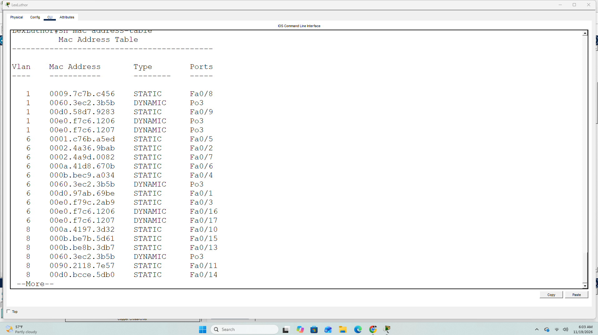
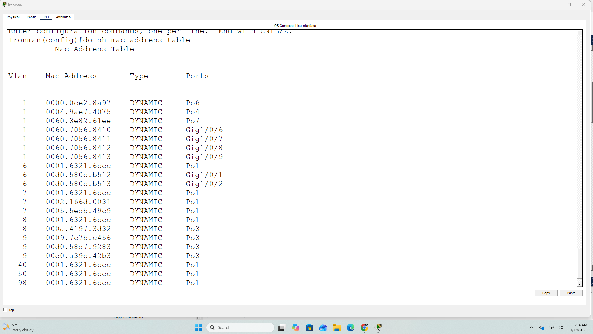
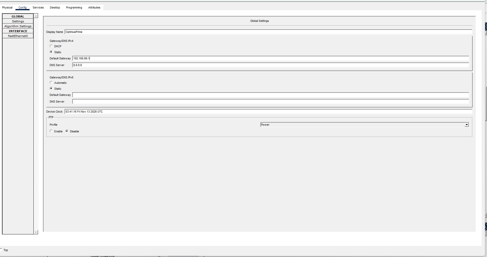

# Hospital Enterprise Network — VLAN 8 to DHCP Server Connectivity Troubleshooting

**Platform:** Cisco Packet Tracer  
**Lab focus:** Layer 2 validation, inter-VLAN routing, and server return-path troubleshooting  
**Status:** **Resolved — ICMP connectivity restored**  
**Environment:** Simulated hospital enterprise network (not a production incident)

## Overview

In this troubleshooting lab, a workstation in **VLAN 8** could reach its local default gateway on **IronMan**, but initially could not reach **OptimusPrime**, the centralized DHCP server in **VLAN 99**. The investigation began by checking switching behavior, VLAN forwarding, EtherChannel, and MAC address learning. Ultimately, **two Layer 3 configuration problems** were found and corrected:

1. **IPv4 routing was not enabled** on the IronMan multilayer switch.
2. **OptimusPrime's default gateway pointed to `192.168.99.1`**, rather than the working IronMan VLAN 99 gateway at `192.168.99.2`.

After both corrections, the VLAN 8 workstation successfully pinged OptimusPrime at `192.168.99.10`.

> **Validation scope:** This lab confirms successful **IP/ICMP reachability** to the DHCP server. A successful DHCP lease from the server was not separately documented in this incident.

## Relevant devices and addressing

| Device | Role | Address / VLAN |
|---|---|---|
| VLAN 8 workstation | Test client on LexLuthor | `192.168.8.50`; gateway `192.168.8.1` |
| LexLuthor | Layer 2 access switch | VLAN 8 client access and trunk uplinks |
| IronMan | Multilayer distribution switch / inter-VLAN router | VLAN 8 SVI `192.168.8.1/25`; VLAN 99 SVI `192.168.99.2/24` |
| CaptainAmerica | Multilayer distribution switch | Part of the existing campus switching topology |
| Thor | Multilayer distribution switch | Part of the existing campus switching topology |
| Bifrost | Layer 2 server access switch | Server VLAN connectivity |
| OptimusPrime | Primary DHCP server | `192.168.99.10/24`; corrected gateway `192.168.99.2` |
| BumbleBee | Secondary DHCP server | `192.168.98.10/24` |

**Client test note:** The VLAN 8 workstation was temporarily assigned a **static address** for troubleshooting. Its initially observed mask was `/24`, whereas the VLAN 8 SVI was `/25`. The intended client mask is **`255.255.255.128`**. Both the test host (`.50`) and gateway (`.1`) are within the same `/25`; that mask discrepancy alone does not explain the confirmed routing and return-path failures.

## 1. Investigating Layer 2 connectivity

Before changing the routing configuration, I checked whether the access and distribution switches were learning MAC addresses and forwarding VLAN 8 traffic.

Commands used included:

```cisco
show mac address-table
show mac address-table vlan 8
show interfaces trunk
show spanning-tree vlan 8
show etherchannel summary
show ip arp
show ip interface brief
```

### LexLuthor MAC address learning



The LexLuthor MAC table showed VLAN 8 devices on local access ports and dynamic MAC learning on **Port-channel 3**. The screenshot includes the test workstation MAC `000B.BE8B.3DB7` on **Fa0/13**. This helped confirm that the access switch was learning the client.

### IronMan MAC address learning



IronMan's MAC address table showed learned entries for VLAN 8 and other hospital VLANs. Separately, IronMan's ARP table resolved both the VLAN 8 client and the primary server:

```text
192.168.8.50    000B.BE8B.3DB7    Vlan8
192.168.99.10   000D.BDD2.C97B    Vlan99
```

These observations supported local Layer 2 reachability. They **did not, by themselves, prove that inter-VLAN routing or the server's return path worked**.

### STP and EtherChannel checks

LexLuthor's **Po3** was observed as **Root FWD** for VLAN 8, and the EtherChannel member ports were bundled. An alternate/blocking STP path was also observed elsewhere in the topology; that is expected behavior for redundant Layer 2 links and was **not identified as the root cause** of this incident.

## 2. Root cause #1 — IP routing disabled on IronMan

The VLAN 8 workstation successfully reached its own gateway:

```text
C:\>ping 192.168.8.1
Packets: Sent = 4, Received = 4, Lost = 0 (0% loss)
```

However, routing investigation on IronMan returned unexpected output:

```cisco
Ironman#show ip route 192.168.99.10

Default gateway is not set
Host               Gateway           Last Use    Total Uses  Interface
ICMP redirect cache is empty
```

Further investigation confirmed that **`ip routing` had not been enabled** on IronMan.

### Fix

```cisco
Ironman#configure terminal
Ironman(config)#ip routing
Ironman(config)#end
```

### Verification

After enabling routing, the VLAN 8 workstation could ping IronMan's SVI in VLAN 99:

```text
C:\>ping 192.168.99.2
Packets: Sent = 4, Received = 4, Lost = 0 (0% loss)
```

**Result:** IronMan was now routing between VLAN 8 and VLAN 99. But the workstation still could **not** ping the server at `192.168.99.10`, so troubleshooting continued.

## 3. Root cause #2 — Incorrect default gateway on OptimusPrime

The workstation's next test timed out:

```text
C:\>ping 192.168.99.10
Request timed out.
Request timed out.
Request timed out.
```

IronMan had already resolved the server's MAC address in VLAN 99. I then inspected OptimusPrime's IPv4 gateway settings.

### Original server gateway



The screenshot shows **`192.168.99.1`** as the configured default gateway, while the working IronMan VLAN 99 SVI was **`192.168.99.2/24`**. The server itself was `192.168.99.10/24`.

The two gateway addresses are within the same subnet, but a default gateway must be a **real, operational Layer 3 next hop with a route back to the source**. In this tested configuration, the server's `.1` gateway did not provide a working return path to VLAN 8.

### Fix

In **OptimusPrime → Config → Global Settings**, I changed the IPv4 default gateway:

```diff
- Default gateway: 192.168.99.1
+ Default gateway: 192.168.99.2
```

The server retained its `192.168.99.10/24` address.

### Final verification

After updating the gateway, the **VLAN 8 workstation successfully pinged `192.168.99.10`**.

**Result: End-to-end ICMP connectivity restored.**

## Troubleshooting results

| Check | Observed result | Conclusion |
|---|---|---|
| LexLuthor learns VLAN 8 client MAC | Yes | Client MAC learning present |
| IronMan resolves client and server ARP entries | Yes | Local neighbor resolution present |
| VLAN 8 PC → `192.168.8.1` | Success, 0% loss | Local gateway reachable |
| VLAN 8 PC → `192.168.99.2` after `ip routing` | Success, 0% loss | Inter-VLAN routing working |
| VLAN 8 PC → `192.168.99.10` before server gateway fix | Timed out | Server path still incomplete |
| VLAN 8 PC → `192.168.99.10` after gateway fix | Success | End-to-end reachability restored |

## Lessons learned

- **Working links and learned MAC addresses do not guarantee end-to-end IP connectivity.** Layer 2 validation and Layer 3 validation answer different questions.
- **SVIs alone are not enough for inter-VLAN forwarding.** The multilayer switch needs IPv4 routing enabled.
- **Always verify the return path.** A server can be reachable from its own subnet yet fail to respond to a client in another VLAN when its default gateway is wrong.
- **Do not assume STP blocking is a fault.** Alternate paths may be blocked by design to prevent loops.
- **Avoid duplicate physical SVI IP addresses.** If multiple switches need to provide a redundant default gateway, use unique SVI addresses and a properly designed FHRP such as HSRP.

## Planned improvements

**HSRP is planned, not implemented as part of this completed fix.** A future VLAN 99 design could use:

| Device | Address | Proposed role |
|---|---|---|
| IronMan | `192.168.99.2/24` | HSRP active |
| CaptainAmerica | `192.168.99.3/24` | HSRP standby |
| Shared virtual gateway | `192.168.99.1` | Server default gateway |

Before using the virtual gateway, both participating switches must share the appropriate VLAN 99 Layer 2 segment, and the standby switch must have a working route back to VLAN 8 when it becomes active.

Additional future work includes routed core switches, OSPF, WAN/branch connectivity, ACL policy testing, and DHCP lease verification.

## YouTube — Troubleshooting walkthrough

I'll add a video walkthrough demonstrating the symptoms, diagnostic commands, configuration fixes, and successful final connectivity test.

**Video:** [Watch the troubleshooting lab on YouTube](PASTE_YOUR_YOUTUBE_VIDEO_URL_HERE)

> Replace `PASTE_YOUR_YOUTUBE_VIDEO_URL_HERE` with the published or unlisted YouTube video URL.

## Screenshots

| Evidence | File |
|---|---|
| Original OptimusPrime default gateway (`192.168.99.1`) | [`01-optimusprime-original-gateway.png`](screenshots/01-optimusprime-original-gateway.png) |
| IronMan MAC address table | [`02-ironman-mac-table.png`](screenshots/02-ironman-mac-table.png) |
| LexLuthor MAC address table, including VLAN 8 | [`03-lexluthor-mac-table.png`](screenshots/03-lexluthor-mac-table.png) |

---

**Project:** Hospital Enterprise Network Lab  
**Topic:** Inter-VLAN Routing and DHCP Server Connectivity  
**Outcome:** Two Layer 3 issues identified and corrected; VLAN 8-to-VLAN 99 ICMP connectivity verified.
